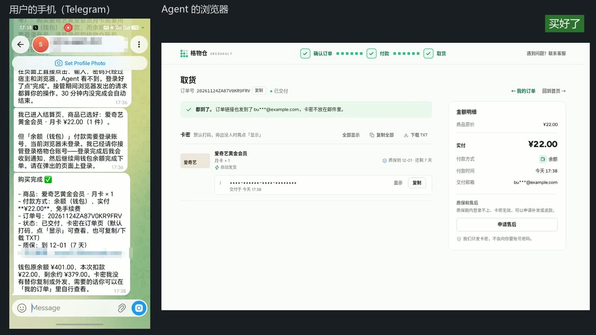
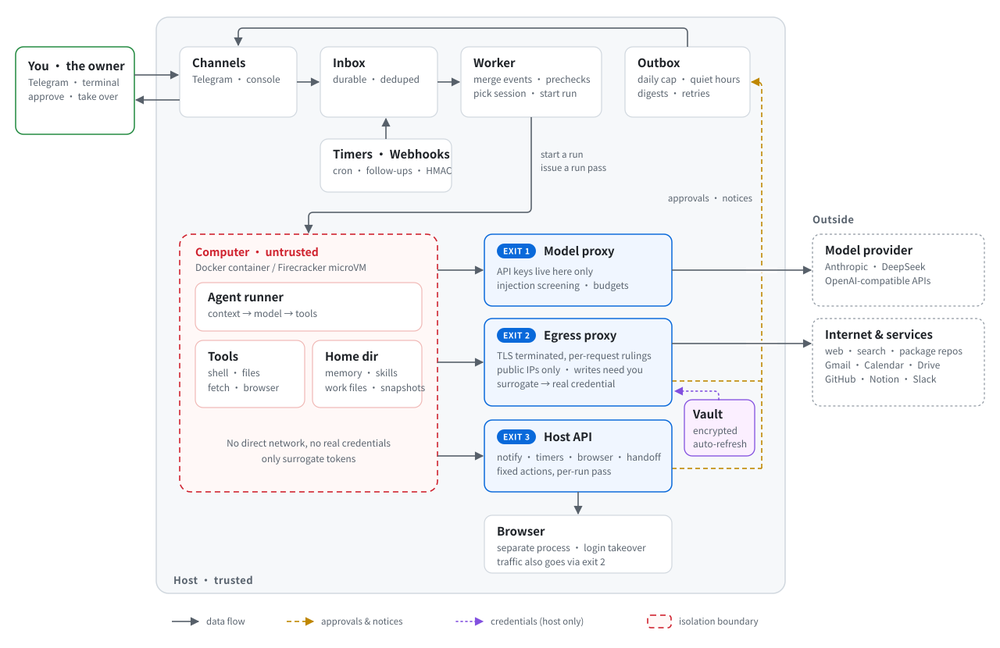

# smra-agent

**Your private AI agent — running on your own machine, working for you alone.**

[中文](README.md) | **English**

[](LICENSE)


smra-agent is a self-hosted, always-on personal assistant. You hand it work from Telegram or a terminal: research,
file analysis, coding, watching your mail and calendar, operating websites, getting things done with your accounts.
It remembers your preferences and unfinished tasks, wakes up on schedules and webhooks, and only pings you when
something matters.

A private agent is valuable precisely because it can touch your things: your inbox, calendar, files and accounts.
So smra-agent is designed on the assumption that the model can be manipulated: **the agent works inside an isolated
computer, every outward action is enforced by code on your host, and real credentials never enter that computer.**

> The detailed docs under `docs/` and the host's chat messages are currently in Chinese. Issues and PRs in English are welcome.

## Demo

[](docs/assets/demo.mp4)

*Click the image to watch the video (77 s).* From Telegram on a phone: "go to the shop and buy a one-month membership
card, pay with the wallet". The agent browses the shop and places the order by itself. Before submitting it asks you
to approve. When payment needs a login, it hands the browser over to you on the phone (the password only passes
through the host and the browser; the agent never sees it). You tap "logged in", it pays with the wallet and reports
back. The shop in the demo is the test shop used by this project.

## Why it is built this way

To be useful, a private agent has to read your mail, run code and hold tokens for your accounts, which puts it one
prompt injection away from a leak. Instead of relying on system-prompt instructions, smra-agent puts the agent in an
isolated computer with exactly three exits, each adjudicated by deterministic code on the host. The computer holds only
surrogate tokens; the host swaps in real credentials as a request leaves. For requests that send data out, the approval
message is built from the actual outgoing bytes, and a "just this once" approval releases only those bytes. Even a
manipulated model cannot cause an outcome you did not agree to.

| | Common approach | smra-agent |
|---|---|---|
| Credentials | API keys in the agent process's environment | Encrypted on the host only; the computer holds host-bound surrogate tokens |
| Network | The agent process has direct internet access | No direct network; every HTTP(S) request is decrypted and adjudicated, public addresses only |
| Sensitive actions | The model decides whether to ask | The host enforces approval by request type, built from the real request |
| Prompt injection | System-prompt instructions | External content is screened before it reaches the model; even a successful injection cannot send anything without approval |
| Recovery | Clean up by hand | Home-directory snapshots; `/restore` rolls back in one command |
| Always-on cost | Call the model on a timer | Prechecks decide whether anything changed; no change, no model call |
| Traceability | Read the logs | `/activity` lists every outbound request, approval and sent message per run |

## Features

- **Isolated execution**: the agent's commands, code and files live in a separate computer that can be restored from
  snapshots. Drivers: Docker container or Firecracker microVM.
- **Every exit is guarded**: every HTTP(S) request from inside goes through the host's egress proxy. Reading public
  content is allowed; anything sent on your behalf (an email, a form, a payment) needs your approval on the phone,
  and the approval is bound to the exact request bytes.
- **Real credentials stay on the host**: tokens for Gmail, GitHub and others are stored encrypted on the host.
  The computer only gets surrogate tokens, which the proxy swaps for the real ones on the way out — and only toward
  the hosts they are bound to.
- **Always on, proactive**: timers, cron schedules and webhooks wake the agent. Precheck scripts decide whether
  anything changed; if not, no model call is made and nothing is spent. Notifications have a daily cap, quiet hours
  and digests.
- **Browser with login takeover**: the agent has its own browser; for logins and CAPTCHAs, a live view is pushed to
  your phone so you can do it yourself.
- **Multiple roles**: define roles such as a researcher or a secretary, each with its own memory, handing tasks to
  each other; hop count and total spend are capped.
- **Provider-agnostic**: Anthropic, DeepSeek, or any OpenAI-compatible API. Prompt-injection screening uses a
  separate, cheaper model.
- **Auditable**: `/activity` lists every run's outbound requests, approvals and sent messages; `/usage` breaks down
  spend by day, role and session.

## Architecture

<p align="center">
  
</p>

The system has two halves. The **host** is trusted: it receives your messages and scheduled events, decides when to
start a run, keeps the credentials, and owns all three exits from the computer to the outside world. The **computer**
is untrusted: the agent runner builds context, calls the model and executes tools there, but it has no direct
network access and holds no real credentials.

| Exit | What it does | How it is guarded |
|---|---|---|
| 1: model proxy | Forwards model calls | API keys live only on the host; newly read external content is screened for prompt injection; metering and budgets |
| 2: egress proxy | All HTTP(S), including the browser | TLS is terminated and every request adjudicated: public addresses only; reading URLs the agent has "seen" is allowed; sending data out needs your approval; surrogate tokens are swapped for real credentials here |
| 3: host API | Send notifications, set timers, drive the browser, hand off to another role | One pass per run, only a fixed set of actions |

### The life of a request

Take "reply to Alice and tell her Friday's meeting moved to 3 pm":

1. The message arrives from Telegram in the **inbox** (durable, deduplicated). The **worker** routes it to the right
   session, starts a run, and gives the computer a pass valid for that run only.
2. The runner in the computer assembles context (system prompt, memory, recent conversation) and calls the model
   through **exit 1**. The model proxy adds the real API key on the host and forwards the call.
3. The model first reads Alice's email. The request goes to Gmail through **exit 2** carrying a surrogate token; the
   egress proxy checks that the destination matches the token's bound hosts, swaps in the real token and lets it
   through. The email body is screened for prompt injection before the next model call.
4. The model drafts the reply and issues `POST .../messages/send`. The adjudicator classifies it as "sent in your
   name", holds the request, extracts recipients, subject and body from the request itself, and pushes an approval
   message to your phone through the **outbox**.
5. You tap approve; the request is released exactly as it was — once, with those bytes. If you don't answer within
   30 seconds, the run is suspended; when you approve later, an approval event wakes the session and the agent
   retries the original request.
6. The agent's reply goes back to you through the **outbox**. Every outbound request and approval is in the activity
   log, available via `/activity`.

Threat model, why the host still runs as root, and where the master key lives: [security model](docs/security.md);
full design: [design doc](docs/design.md) (Chinese).

## Installation

### Requirements

| | Try it (local driver) | Container isolation (docker driver) | microVM (firecracker driver) |
|---|---|---|---|
| OS | Linux / Windows (macOS untested) | Linux | Linux with `/dev/kvm` |
| Dependencies | Python 3.12+, [uv](https://docs.astral.sh/uv/) | plus Docker | plus Firecracker and jailer |
| Isolation | **None** — commands run directly on your machine | Container + dedicated network | Virtual machine |

You also need an API key for a model provider, and a Telegram bot for always-on use.

### 1. Get the code and install dependencies

```bash
git clone https://github.com/cdt2019/smra-agent.git smra-agent
cd smra-agent
uv sync
uv run playwright install chromium    # needed for browser features; optional if Microsoft Edge is installed
```

### 2. Configure

```bash
cp .env.example .env
```

At minimum, put a model API key in `.env`. The default provider is Anthropic:

```bash
ANTHROPIC_API_KEY=sk-ant-...
```

For DeepSeek or an OpenAI-compatible API, set `SMRA_MODEL_PROVIDER` and the matching key; see
[model providers](docs/deploy.md#模型提供方). `.env` is read only on the host and never enters the computer.

### 3. Try it in a terminal

```bash
uv run python -m host.main --channel console --driver local
```

The local driver has no isolation and is for trying things out only. On Linux, switch to container isolation
(the first start builds the image and takes a few minutes):

```bash
uv run python -m host.main --channel console --driver docker
```

The host runs a self-check at startup and exits with a clear message if, say, a key or Docker is missing.
You can also run it on its own: `uv run python -m host.doctor`.

### 4. Install as a service (Linux)

1. Create a bot with [@BotFather](https://t.me/BotFather) on Telegram and set `TELEGRAM_BOT_TOKEN` and your own
   `TELEGRAM_CHAT_ID` in `.env` (the bot only answers that chat).
2. Run the installer as root. It installs dependencies, runs the self-check, puts the master key into an encrypted
   systemd credential, writes the unit file and hardening drop-ins, and starts the service:

   ```bash
   sudo sh deploy/install.sh --dry-run   # show what would change first
   sudo sh deploy/install.sh
   ```

3. Status and logs:

   ```bash
   systemctl status smra-agent
   journalctl -u smra-agent -f
   uv run python -m host.status          # any unfinished runs? safe to restart?
   ```

To upgrade: `git pull`, then run `sudo sh deploy/install.sh` again. Backups, restore and retention:
[deployment and operations](docs/deploy.md).

## Usage

The host's own messages are in Chinese today; they are translated below for readability. You can talk to the agent
in any language the model understands.

### Just talk to it

```text
You:   Analyze this CSV and make a report with charts           (file attached)
Agent: Done — the report is at work/report/sales_report.html and has been sent to you.
       Key findings: 1. Total revenue 2.2276M ...
```

```text
You:   Look up this week's Hacker News discussions about Firecracker and give me three takeaways
You:   @researcher compare pricing of a few vector databases, then hand it to the secretary to draft an email
```

Roles (like `researcher` above) are defined by you in `data/core/roles/`; each has its own memory and they can hand
tasks to each other. See [roles](docs/agent.md#多角色).

### Things that need your approval

When the agent sends something on your behalf, the host builds the approval message from the **actual outgoing
request** — not from the agent's description of it:

```text
Approval needed: Gmail — send an email, subject: Friday's meeting moved to 3 pm
Why I'm asking: it goes out in your name and others will see it
To: alice@example.com
Body:
Hi Alice, Friday's meeting is moved to 3 pm, same room.
(raw request: POST https://gmail.googleapis.com/gmail/v1/users/me/messages/send, 1234 bytes)

Approval id: apr_3f9a1c2e7b4d5a60
Approve: /approve apr_3f9a1c2e7b4d5a60 [scope]   Deny: /deny apr_3f9a1c2e7b4d5a60
Scopes: once
```

Tap the buttons under the message in Telegram, or reply `/approve <id>`. Read requests can be granted longer scopes
(this run, this session, one hour, forever).

### Connect accounts and let it work in the background

```bash
uv run python -m host.creds add gmail --google-login   # authorize in a browser; the token stays on the host
uv run python -m host.creds add github                 # fine-grained personal access token
uv run python -m host.creds list
```

```text
You:   Send me a brief every morning at 8: today's calendar and emails I need to answer
Agent: OK, scheduled: every day at 08:00 using the morning-brief skill.

You:   Keep an eye on my mail — tell me right away when a client writes, skip notifications
Agent: Scheduled: a check every 30 minutes during the day. With no new mail only the check script runs, no model call.
```

Three skills ship with it: morning brief (`morning-brief`), mail watch (`mail-watch`) and calendar watch
(`calendar-watch`). The agent can also write its own skills and propose service profiles for new APIs (you confirm
them). See [integrations](docs/integrations.md).

### Common commands

| Command | What it does |
|---|---|
| `/status` | What it is doing, what is waiting for you, today's spend, connected accounts |
| `/activity [days]` | Outbound requests, approvals and sent messages per run |
| `/usage [days]` | Spend by day, role and session |
| `/approve <id> [scope]`, `/deny <id>` | Approve or deny a network request |
| `/timers`, `/run <id>`, `/cancel <id>` | Manage timers and schedules |
| `/skill <name> [request]`, `/skills` | Run a skill now; list bundled skills |
| `/snapshot`, `/snapshots`, `/restore <n>` | Snapshot and restore the home directory |
| `/new` | Start a new conversation (memory and files are kept) |
| `@<role> message` | Talk to a specific role |

`/help` lists all commands.

## Project status

Current version: 0.1.0.

- Docker and local drivers: fully tested.
- **Firecracker microVM driver: code complete, acceptance tests not yet run on a machine with KVM.** Tests that need
  KVM (`tests/test_step9_vm.py`) are skipped automatically.
- The local driver has **no isolation at all**; use it for development and trying things out, not for always-on use.
- What each acceptance item covers and how it was tested: [verification status](docs/verification.md).

## Documentation (Chinese)

| Doc | Contents |
|---|---|
| [Deployment and operations](docs/deploy.md) | Model providers, run modes, systemd, self-check, status, spend, backup and restore, retention, microVM |
| [Security model](docs/security.md) | How egress is adjudicated, host hardening, where the master key lives |
| [Integrations](docs/integrations.md) | Gmail, Google Calendar and Drive, GitHub, Notion, Slack; agent-proposed services; skills; webhooks |
| [Browser](docs/browser.md) | Where the browser runs, login takeover, browser request rules, site profiles |
| [When the agent wakes up and speaks](docs/agent.md) | Timers, notification pacing, multiple roles, the notify eval |
| [Voice, photos and files](docs/media.md) | Speech-to-text, image description, sending and receiving files |
| [Design doc](docs/design.md) | Overall design; "section N" in code comments refers to this |
| [Implementation notes](docs/design-notes.md) | Where the code differs from or goes beyond the design doc |
| [Verification status](docs/verification.md) | Which acceptance items have been tested |
| [Changelog](CHANGELOG.md) | What changed in each version |

## Repository layout

```
host/            Host (trusted): inbox, worker, timers, outbox, the three exits, credentials, browser, backup …
  egress/        Exit 2: egress proxy, adjudicator, service profiles, address checks
  computer/      Computer drivers: firecracker, docker, local
  channels/      Channels: telegram, console
cell/            Inside the computer (untrusted): the run program, tool implementations, images
browser/         Browser container image
profiles/        Bundled service profiles (gmail, gcalendar, gdrive, github, notion, slack)
skills/          Bundled skills (morning-brief, mail-watch, calendar-watch)
deploy/          systemd unit, hardening, installer
evals/           Notify eval (calls a real model and costs money)
tests/           Automated tests
docs/            Documentation
```

## Development

```bash
uv run pytest -q     # full test suite — no API keys, no cost
uv run ruff check    # lint
uv run mypy          # type check (host/)
```

In tests the model provider and external websites are replaced by local fakes; everything else runs for real
(worker, subprocesses, SDK, both proxies, tools). The full suite takes about 6 minutes on Linux and about 20 on
Windows. Docker driver acceptance: `SMRA_TEST_DOCKER=1 uv run pytest tests/test_docker.py -s`.

See [CONTRIBUTING.md](CONTRIBUTING.md) to contribute. Please report security issues privately as described in
[SECURITY.md](SECURITY.md), not in public issues.

## License

[MIT](LICENSE)
