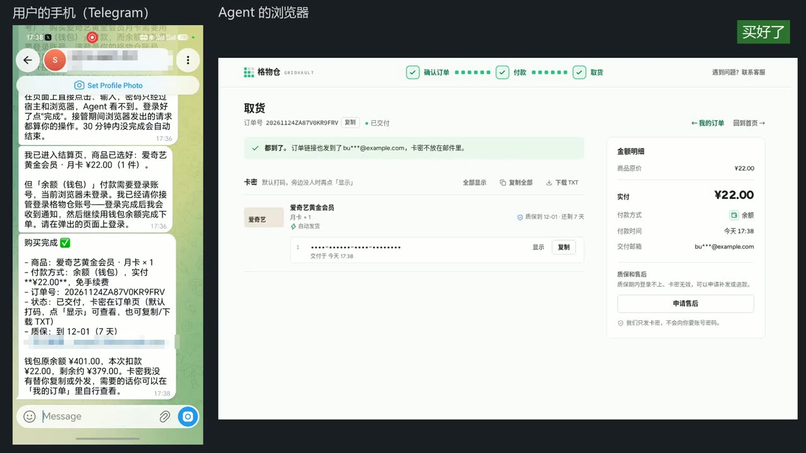
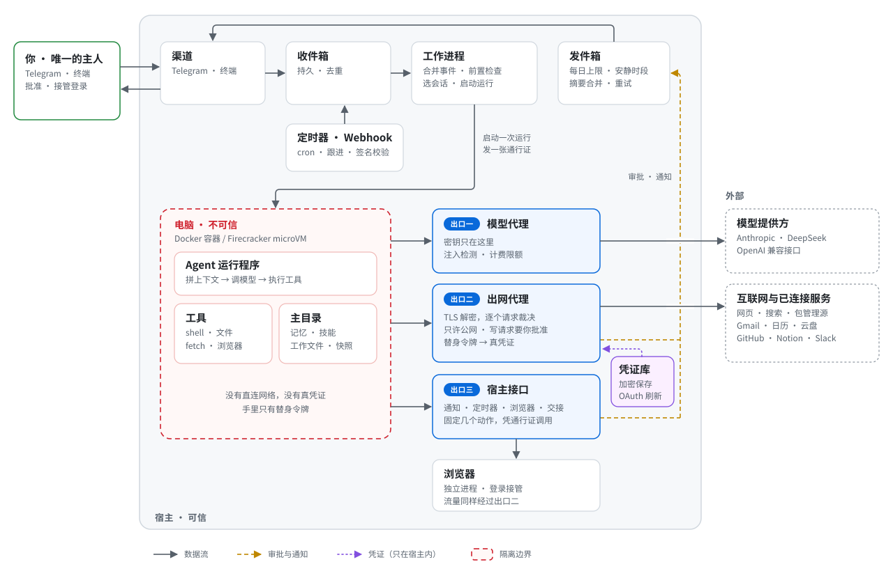

# smra-agent

**你的私人 AI 助手（Private Agent）——跑在你自己的机器上，只为你一个人工作。**

**中文** | [English](README.en.md)

[](LICENSE)


smra-agent 是一个自托管、7×24 小时在线的私人助手。你在 Telegram 或终端里给它派活：查资料、分析文件、写代码、
盯邮件和日程、操作网页、用你的账号替你办事。它记得你的偏好和手上没做完的事，按日程和 Webhook 自己醒来干活，
有要紧的事才通知你。

私人助手的价值来自它能碰你的东西：你的邮箱、日历、文件和各种账号。所以 smra-agent 把"模型可能被操纵"当作设计前提：
**Agent 在一台隔离的电脑里干活，每一个对外动作都由你的宿主用代码把关，真凭证永远不进那台电脑。**

## 演示

[](docs/assets/demo.mp4)

*点图片看视频（77 秒）。* 在手机 Telegram 上说一句"去格物仓买一张会员月卡，用钱包付"：Agent 自己逛店、下单；
提交订单前问你批准；付款需要登录时，把浏览器交给你在手机上登录（密码只经过宿主和浏览器，Agent 看不到）；
你点"登录好了"，它接着用钱包付款并把结果发回来。演示用的是本项目测试用的网店。

## 为什么这样设计

一个私人助手要有用，就得能读你的邮件、执行代码、拿着你各种账号的令牌，这样的 Agent 离泄露只差一次提示注入。
smra-agent 不靠系统提示词约束模型，而是把它关进一台隔离的电脑：电脑通向外界只有三个出口，每个都由宿主上的确定性代码裁决；
电脑里只有替身令牌，真凭证在请求离开时才由宿主换上；往外发数据的请求，审批消息根据实际要发出的字节生成，
"仅这一次"的批准只放行这些字节。即使模型被操纵，也造不成你没同意的后果。

| | 常见做法 | smra-agent |
|---|---|---|
| 凭证 | API key 放在 Agent 进程的环境变量里 | 只在宿主上加密保存；电脑里只有绑定主机的替身令牌 |
| 网络 | Agent 进程直接联网 | 没有直连网络；每个 HTTP(S) 请求解密后逐个裁决，只许公网地址 |
| 敏感操作 | 由模型判断要不要问用户 | 由宿主按请求类型强制审批，审批内容取自实际请求 |
| 提示注入 | 靠系统提示词约束 | 外部内容进模型前过检测；就算注入成功，没有批准也发不出去 |
| 出错恢复 | 手动收拾 | 主目录快照，`/restore` 一条命令回滚 |
| 常驻成本 | 定时调用模型 | 前置检查判断有无变化，没变化不调模型 |
| 可追溯 | 看日志 | `/activity` 按运行列出每个对外请求、审批和发出的消息 |

## 特点

- **隔离运行**：Agent 的命令、代码、文件都在一台单独的电脑里，坏了可以从快照恢复。驱动可选 Docker 容器或 Firecracker microVM。
- **每个出口都有人把关**：电脑里发出的每个 HTTP(S) 请求都要经过宿主的出网代理。读取公开内容直接放行；
  以你的名义发出去的（发邮件、提交表单、付款）要你在手机上批准，批准绑定具体的请求内容。
- **真凭证不进电脑**：Gmail、GitHub 等账号的令牌加密存在宿主上。电脑里只有替身令牌，代理在发出时才换成真的，并且只发往绑定的主机。
- **常驻、主动**：定时器、cron 日程、Webhook 叫醒 Agent；前置检查脚本判断"有没有新东西"，没有就不调用模型、不花钱。
  通知有每日上限、安静时段和摘要合并。
- **浏览器和登录接管**：Agent 有自己的浏览器；遇到登录、验证码，把实时画面推到你手机上由你操作。
- **多角色**：可以定义研究员、秘书之类的角色，各有自己的记忆，互相交接任务；交接跳数和总花费都有上限。
- **不绑定模型提供方**：Anthropic、DeepSeek，以及任何 OpenAI 兼容接口。注入检测用另一个便宜的模型。
- **可审计**：`/activity` 列出每次运行的对外请求、审批和发出的消息；`/usage` 按天、角色、会话统计花费。

## 架构

<p align="center">
  
</p>

系统分成两半。**宿主**是可信的：它接收你的消息和定时事件，决定什么时候启动一次运行，保管凭证，
并且掌握电脑通向外界的全部三个出口。**电脑**是不可信的：Agent 的运行程序在里面拼上下文、调用模型、执行工具，
但它没有直连网络，手里也没有任何真凭证。

| 出口 | 做什么 | 把关方式 |
|---|---|---|
| 一：模型代理 | 转发对模型的调用 | 密钥只在宿主上；新读到的外部内容先过注入检测；记账、限额 |
| 二：出网代理 | 一切 HTTP(S)，包括浏览器 | 解密后逐个请求裁决：只许公网地址；读"见过"的地址放行；向外发数据要你批准；替身令牌在这里换成真凭证 |
| 三：宿主接口 | 发通知、设定时器、操作浏览器、交给另一个角色 | 每次运行一张通行证，只能调用固定的几个动作 |

### 一次请求走过的路

以"帮我给 Alice 回封邮件，说周五的会改到下午三点"为例：

1. 消息从 Telegram 进入**收件箱**（持久化、去重）。**工作进程**把它归到对应的会话，启动一次运行，发给电脑一张这次运行专用的通行证。
2. 电脑里的运行程序拼好上下文（系统提示词、记忆、最近的对话），经**出口一**调用模型。模型代理在宿主上加上真正的 API 密钥再转发。
3. 模型决定先读 Alice 的来信。请求经**出口二**发往 Gmail，带的是替身令牌；出网代理确认目的主机和令牌绑定的一致，换成真令牌放行。
   读回来的邮件正文在下一次调用模型前先过注入检测。
4. 模型写好回信，发出 `POST .../messages/send`。裁决者判定这是"以你的名义发送"，把请求挂住，
   从请求体里解出收件人、主题、正文，生成审批消息经**发件箱**推到你手机上。
5. 你点"批准"，请求原样放行，并且只放行这一次、这些字节。30 秒内没答复，这次运行先挂起结束；
   你之后批准时，一条审批事件把会话叫醒，Agent 重试原请求。
6. Agent 的回复由宿主经**发件箱**发回给你。整个过程的对外请求和审批都记在活动记录里，`/activity` 可查。

威胁模型、为什么宿主仍以 root 运行、主密钥放在哪里，见 [安全模型](docs/security.md)；完整设计见 [设计文档](docs/design.md)。

## 安装

### 环境要求

| | 试用（local 驱动） | 容器隔离（docker 驱动） | microVM（firecracker 驱动） |
|---|---|---|---|
| 系统 | Linux / Windows（macOS 未测试） | Linux | Linux，有 `/dev/kvm` |
| 依赖 | Python 3.12+、[uv](https://docs.astral.sh/uv/) | 再加 Docker | 再加 Firecracker、jailer |
| 隔离 | **没有**，命令直接跑在本机 | 容器 + 独立网络 | 虚拟机 |

还需要一个模型提供方的 API 密钥。常驻使用要一个 Telegram 机器人。

### 1. 取代码、装依赖

```bash
git clone https://github.com/cdt2019/smra-agent.git smra-agent
cd smra-agent
uv sync
uv run playwright install chromium    # 用浏览器功能时需要；有本机 Edge 也可以不装
```

### 2. 配置

```bash
cp .env.example .env
```

在 `.env` 里至少填模型密钥。默认提供方是 Anthropic：

```bash
ANTHROPIC_API_KEY=sk-ant-...
```

换 DeepSeek 或 OpenAI 兼容接口：设 `SMRA_MODEL_PROVIDER` 并填对应的密钥，见 [模型提供方](docs/deploy.md#模型提供方)。
`.env` 只在宿主侧读取，不会进入电脑。

### 3. 在终端里试

```bash
uv run python -m host.main --channel console --driver local
```

local 驱动不隔离，只用来体验。在 Linux 上换成容器隔离（第一次启动会构建镜像，要几分钟）：

```bash
uv run python -m host.main --channel console --driver docker
```

启动时会先自检，缺密钥、缺 Docker 之类的问题会说清楚并退出。也可以单独跑 `uv run python -m host.doctor`。

### 4. 装成常驻服务（Linux）

1. 在 Telegram 找 [@BotFather](https://t.me/BotFather) 建一个机器人，在 `.env` 填 `TELEGRAM_BOT_TOKEN` 和你自己的 `TELEGRAM_CHAT_ID`
   （机器人只回应这个对话）。
2. 用 root 运行安装脚本。它会装依赖、自检、把主密钥放进 systemd 加密凭证、写好单元文件和权限收紧配置，然后启动服务：

   ```bash
   sudo sh deploy/install.sh --dry-run   # 先看会改哪些文件
   sudo sh deploy/install.sh
   ```

3. 看状态和日志：

   ```bash
   systemctl status smra-agent
   journalctl -u smra-agent -f
   uv run python -m host.status          # 手上有没有没跑完的运行，能不能重启
   ```

升级：`git pull` 后再跑一次 `sudo sh deploy/install.sh`。备份、恢复、保留期限见 [部署与运维](docs/deploy.md)。

## 使用示例

### 直接说话

```text
你：    把这份 CSV 分析一下，出个带图的报告          （附上文件）
Agent： 分析完成，报告在 work/report/sales_report.html，已发给你。
        核心结论：1. 总收入 222.76 万元……
```

```text
你：    查一下这周 Hacker News 上关于 Firecracker 的讨论，整理成三条要点
你：    @researcher 调研一下几家向量数据库的价格，整理好交给秘书写成邮件草稿
```

角色（上面的 researcher）由你在 `data/core/roles/` 里定义，每个角色有自己的记忆，可以互相交接任务，见 [多角色](docs/agent.md#多角色)。

### 需要你批准的事

Agent 以你的名义往外发东西时，宿主根据**实际要发出的请求**生成审批消息（不是 Agent 自己的说法）：

```text
需要你批准：Gmail — 用 Gmail 发送邮件，主题：周五的会改到下午三点
为什么要问：会以你的名义发出去，别人能看到
收件人：alice@example.com
正文：
Hi Alice，周五的会改到下午三点，地点不变。
（原始请求：POST https://gmail.googleapis.com/gmail/v1/users/me/messages/send，1234 字节）

审批号：apr_3f9a1c2e7b4d5a60
批准：/approve apr_3f9a1c2e7b4d5a60 [范围]　拒绝：/deny apr_3f9a1c2e7b4d5a60
范围：once=仅这一次
```

在 Telegram 里点消息下面的按钮，或者回复 `/approve <审批号>`。读取类的请求可以授权更长的范围（本次运行、本次会话、一小时、永久）。

### 连接账号、让它常驻干活

```bash
uv run python -m host.creds add gmail --google-login   # 在浏览器里授权；令牌只存在宿主上
uv run python -m host.creds add github                 # fine-grained 个人访问令牌
uv run python -m host.creds list
```

```text
你：    每天早上 8 点给我发个简报：今天的日程、要回的邮件
Agent： 好，设了日程：每天 08:00 按 morning-brief 技能发简报。

你：    帮我盯着邮件，客户来信马上告诉我，通知类的不用说
Agent： 设了日程：白天每半小时检查一次。没有新邮件时只跑检查脚本，不调用模型。
```

自带三个技能：早间简报（morning-brief）、盯邮件（mail-watch）、盯日历（calendar-watch）。Agent 也可以自己写技能、
自己提交新服务的接入档案（要你确认）。见 [接入外部服务](docs/integrations.md)。

### 常用命令

| 命令 | 作用 |
|---|---|
| `/status` | 现在在忙什么、等你处理的、今日花费、已连接的账号 |
| `/activity [天数]` | 每次运行的对外请求、审批、发出的消息 |
| `/usage [天数]` | 花费：按天、按角色、按会话 |
| `/approve <审批号> [范围]`、`/deny <审批号>` | 批准或拒绝一个网络请求 |
| `/timers`、`/run <号>`、`/cancel <号>` | 管理定时器和日程 |
| `/skill <技能名> [要求]`、`/skills` | 现在按某个技能做一次；列出自带技能 |
| `/snapshot`、`/snapshots`、`/restore <序号>` | 主目录快照和恢复 |
| `/new` | 开新对话（记忆和文件保留） |
| `@<角色> 消息` | 对某个角色说话 |

`/help` 列出全部命令。

## 项目状态

当前版本 0.1.0。

- Docker 驱动和 local 驱动：完整测试，日常使用。
- **Firecracker microVM 驱动：代码已完成，还没有在有 KVM 的机器上跑过验收。** 需要 KVM 的测试（`tests/test_step9_vm.py`）会自动跳过。
- local 驱动**没有任何隔离**，只用于开发和体验，不要用它常驻。
- 每一项验收测了什么、怎么测的，见 [验证状态](docs/verification.md)。

## 文档

| 文档 | 内容 |
|---|---|
| [部署与运维](docs/deploy.md) | 模型提供方、运行方式、systemd 常驻、自检、状态、花费、备份与恢复、保留期限、microVM |
| [安全模型](docs/security.md) | 网络出口怎么判、宿主的权限收紧、主密钥放哪 |
| [接入外部服务](docs/integrations.md) | Gmail、Google 日历和云盘、GitHub、Notion、Slack；Agent 自己接入新服务；技能；Webhook |
| [浏览器](docs/browser.md) | 浏览器放在哪、登录接管、浏览器请求的判定规则、网站档案 |
| [Agent 什么时候醒、什么时候说话](docs/agent.md) | 定时器、通知节奏、多角色、"发不发"评测 |
| [语音、照片和文件](docs/media.md) | 语音转文字、看图、收发文件 |
| [设计文档](docs/design.md) | 整体设计；代码注释里的"第几节"指这里 |
| [实现选择](docs/design-notes.md) | 和设计文档有出入、或者文档没写到的地方 |
| [验证状态](docs/verification.md) | 每一步的验收项测过没有 |
| [更新记录](CHANGELOG.md) | 每个版本改了什么 |

## 目录结构

```
host/            宿主（可信）：收件箱、工作进程、定时器、发件箱、三个出口、凭证、浏览器、备份……
  egress/        出口二：出网代理、裁决者、服务档案、地址检查
  computer/      电脑驱动：firecracker、docker、local
  channels/      渠道：telegram、console
cell/            电脑里（不可信）：一次运行的程序、工具实现、镜像
browser/         浏览器容器镜像
profiles/        自带的服务档案（gmail、gcalendar、gdrive、github、notion、slack）
skills/          自带技能（morning-brief、mail-watch、calendar-watch）
deploy/          systemd 单元、权限收紧、安装脚本
evals/           "发不发"评测（调用真实模型，会产生费用）
tests/           自动化测试
docs/            文档
```

## 开发

```bash
uv run pytest -q     # 全部测试，不需要密钥、不花钱
uv run ruff check    # 代码检查
uv run mypy          # 类型检查（host/）
```

测试里模型提供方和外部网站都换成了本机的假服务，其余走真实路径（工作进程、子进程、SDK、两个代理、工具）。
全套在 Linux 上约 6 分钟、Windows 上约 20 分钟。容器驱动的验收：`SMRA_TEST_DOCKER=1 uv run pytest tests/test_docker.py -s`。

贡献方式见 [CONTRIBUTING.md](CONTRIBUTING.md)。发现安全问题请按 [SECURITY.md](SECURITY.md) 私下报告，不要开公开 issue。

## 许可

[MIT](LICENSE)
